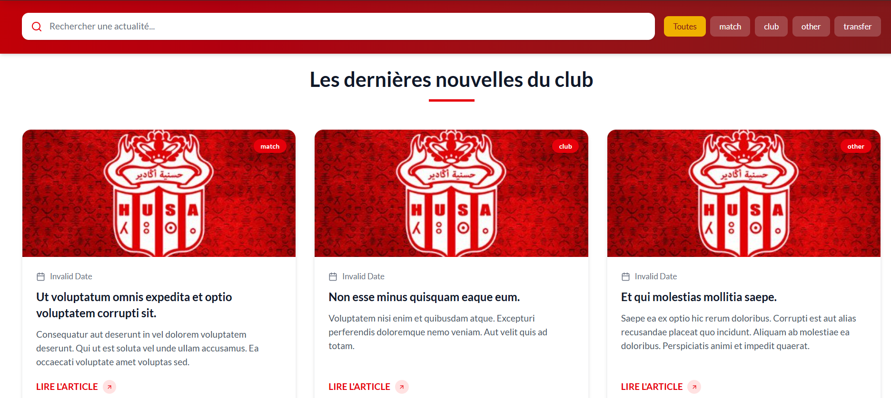
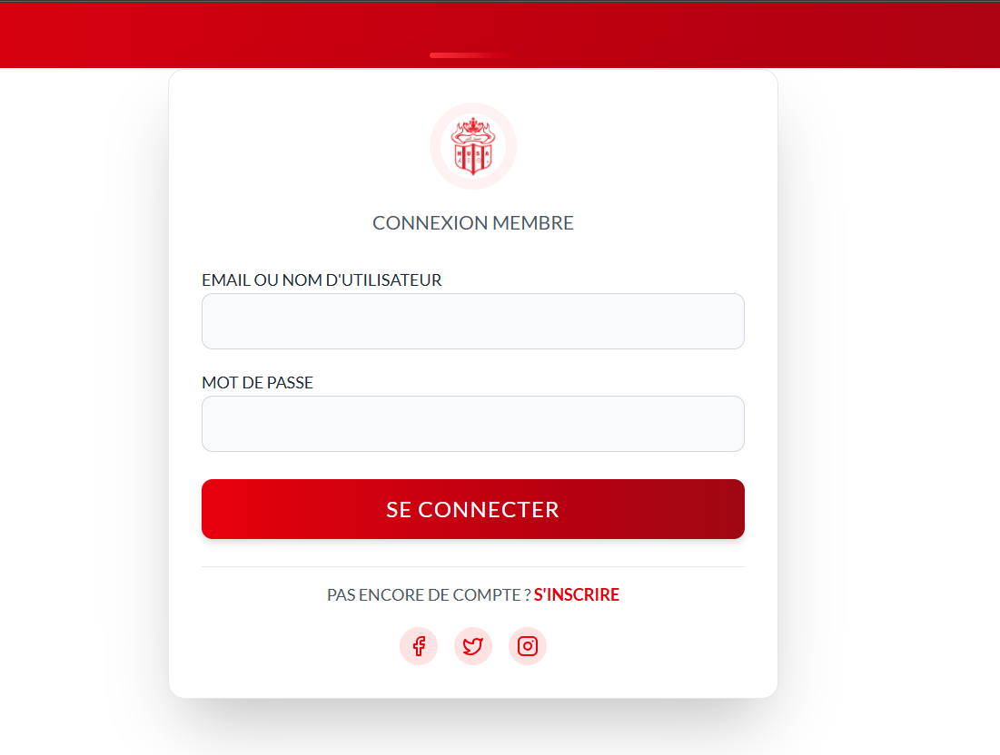
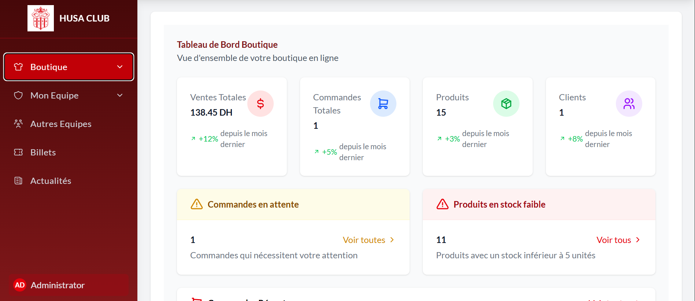

# Club Sport Management Platform


## Description
Complete web platform for the sports club including public area (news, match schedule, gallery, club presentation), integrated e-commerce store and centralized administration panel.

---
## Screenshots
*(Replace with your actual screenshots in the `Screenshots/` folder)*  
  
  
  
  
  
  


## Features

### Public Area
- Club news and announcements  
- Match schedule and results  
- Photo gallery  
- Club presentation / About page  

### E-commerce Store
- Product catalog with categories  
- Shopping cart and checkout functionality  
- Integrated with the administration panel for order management  

### Centralized Administration Panel
- Manage news, matches, gallery content  
- Manage products, orders, and payments  
- Monitor club activities and statistics  
- User authentication with role-based access control  

### Additional Features
- Responsive design for desktop and mobile devices  
- CRUD operations for members, matches, products, and orders  
- View statistics and generate reports for club activities
---
---
**Built With:** Laravel, React, MySQL, JavaScript, HTML, CSS  

## Installation

### Backend (Laravel)
1. Clone the repository:
```bash
git clone https://github.com/Yassine-Tihmmou/club-sport-management.git
cd club-sport-management/backend
