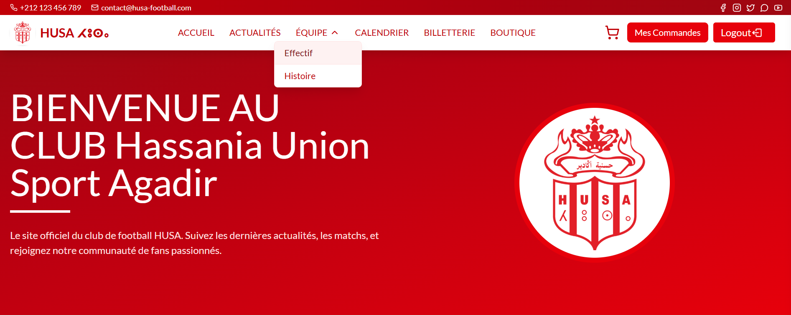
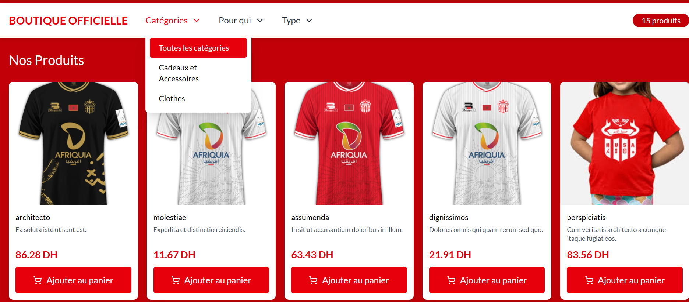
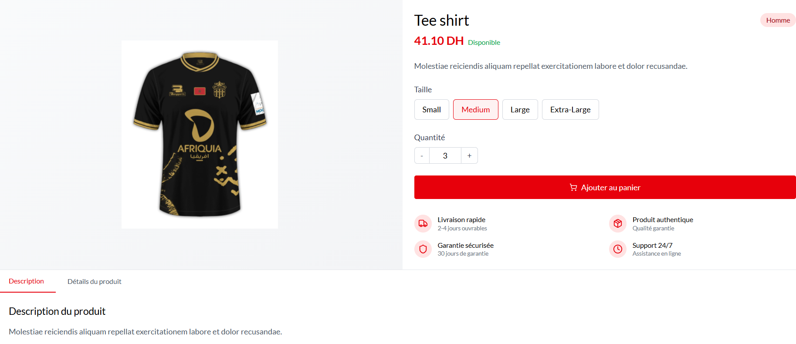
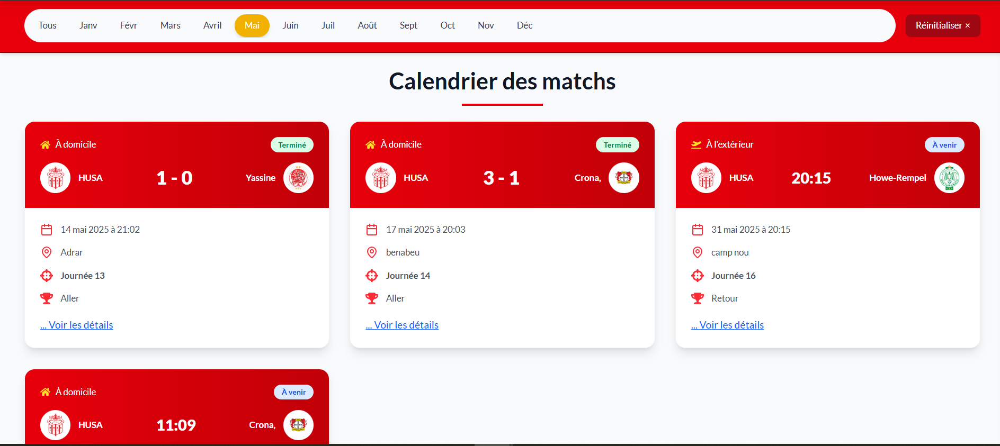
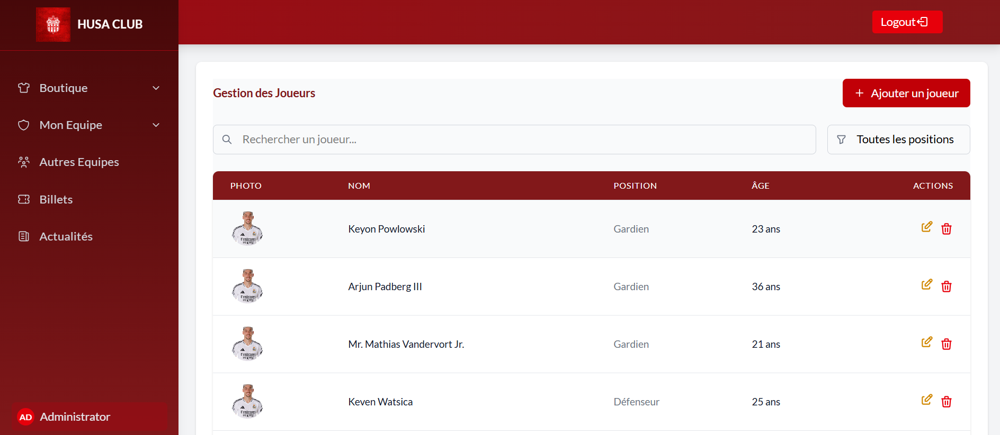

# Club Sport Management

A web platform for a football club. It has a **public website** for fans, an **online shop** for official merchandise, and an **admin panel** to run all of it.

Built during my final-year internship at **Norsys Afrique** (Agadir, May–June 2025), in a team of two developers.




## Features

**Public website**
- Club news with comments
- Match calendar and results, filtered by month
- Squad and player profiles, club history and trophies
- Ticket sales (*billetterie*)

**Online shop**
- Product catalog with categories and filters
- Product pages with sizes and quantities
- Shopping cart and a multi-step checkout with order confirmation

**Admin panel**
- Shop dashboard: sales, orders, low-stock alerts
- Manage products, orders, tickets, news, players, matches, opponents and trophies
- Separate admin and fan areas, routed by the user's role

**Accounts**
- Sign-up and login with Laravel Sanctum
- Email verification and password reset

## Screenshots

| | |
|---|---|
| <br/>**Online shop** | <br/>**Product page** |
| <br/>**Match calendar** | <br/>**Club news** |
| <br/>**Admin: shop dashboard** | <br/>**Admin: player management** |

## Team and my role

We were two developers. We split the work by feature and merged regularly through Git.

**My part:**
- **Database design:** schema, migrations, model relationships, factories and seeders
- **Authentication:** Laravel Breeze + Sanctum API, connected to the React login and sign-up pages
- **Admin panel foundation:** layout, sidebar and navigation
- **The whole online shop:** product and category management, catalog with filters, product pages, cart, multi-step checkout and orders
- **Ticketing:** ticket management for admins and ticket pages for fans
- **Squad and match calendar** pages
- This README and the screenshots

My teammate built news (with comments), player, trophy and match management, and the statistics pages.

## Tech stack

| Layer | Technologies |
|---|---|
| Backend | PHP 8.2, Laravel 12, Laravel Sanctum, Eloquent ORM |
| Frontend | React 19, React Router 7, Tailwind CSS 4, Axios, Vite |
| Database | MySQL |

The backend is a REST API (`API/`). The frontend is a separate React single-page app (`FRONT/`).

## Run it locally

**Requirements:** PHP 8.2+, Composer, Node.js 20+, MySQL

```bash
# Backend: http://127.0.0.1:8000
cd API
composer install
cp .env.example .env          # set DB_DATABASE, DB_USERNAME, DB_PASSWORD
php artisan key:generate
php artisan migrate --seed
php artisan storage:link
php artisan serve

# Frontend: http://localhost:5173
cd ../FRONT
npm install
npm run dev
```

The frontend expects the API at `http://127.0.0.1:8000`.

## What I learned

- Splitting a project between two developers and merging through Git without breaking each other's work
- Designing the relational schema first, because orders, products, stock and tickets all depend on it
- Building a checkout flow end to end, from cart state in React to order records in the database
- Working the way a company does: requirements, regular check-ins with the supervisor, and a final demo
